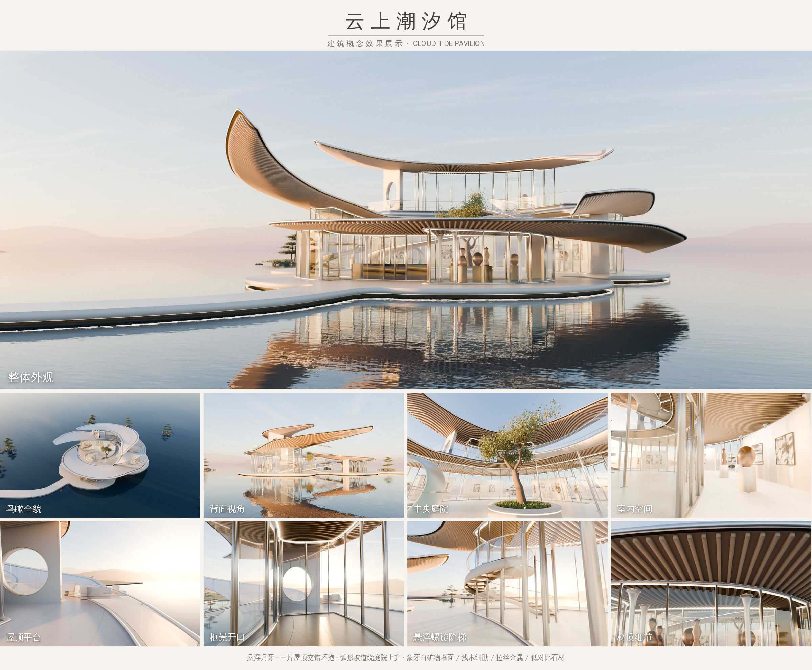

# 云上潮汐馆 · Cloud Tide Pavilion

一座浮在水面上的月牙形展馆，用 Blender（bpy）以 Python 程序化生成，用 Cycles 渲染。



## 设计概念

- **悬浮的月牙**：三片月牙形屋顶围绕圆形庭院交错环抱，中间留出一处有雕塑感的负空间（庭院）。从鸟瞰角度看，三片屋顶像一道回旋的潮汐。
- **屋顶主次分明**
  - **A 主屋顶**：在北侧舒展开来，西端翼尖扬到 11 m 高，中段平整，用作二层屋面平台。
  - **B 次屋顶**：位于二层观景厅之上。东端轻轻回旋下垂，西端缓缓抬起，内缘探到庭院上空。
  - **C 第三屋顶**：在南侧低低地贴近水面。它覆盖入口门廊，东端翼尖降到离水面约 2 m。
- **空间序列**：栈桥 → 低矮的门廊（C 屋顶下，净高约 3 m）→ 门厅 → 明亮的中央庭院（视线直达）。庭院里，弧形坡道绕庭院约 300° 上升到屋面平台，沿途交替看到水面、树影、雕塑和屋顶曲线。
- **庭院**：一棵橄榄树稍稍偏离圆心，对面放一件扭转环带形的磨砂玻璃雕塑，两者相互平衡。
- **框景开口**：屋面平台西端有一道径向直墙，墙顶贴合 B 屋顶底面，墙上开一个直径 2.84 m 的圆洞（月洞）。从二层观景厅向西看，远处的水面和天空穿过月洞进入室内。
- **悬浮螺旋阶梯**：位于一层西厅，没有中柱，由双螺旋梁加悬挑橡木踏步组成，通向一个用 4 根吊杆悬挂的小圆形平台。

## 构造细节（均在代码中参数化）

| 部位 | 做法 |
|---|---|
| 屋檐 | 楔形截面：核心厚 0.55–0.85 m，边缘收薄到 0.15 m；边缘是半圆形的拉丝金属包边 |
| 檐下 | 12 cm 宽的深色阴影缝；浅木细肋以庭院中心为极点径向排布，沿屋面底部曲率连续，端部用二分法精确收在阴影缝内线上 |
| 排水 | 距屋檐 0.45–0.75 m 处有一圈余弦形浅槽，内衬深色金属格栅，与曲面融为一体 |
| 幕墙 | 沿曲线等宽分段（约 1.5 m），竖梃与室内柱位一一对应；顶部有连续的金属收口带封到屋面底板，室内侧藏有向上照亮木肋的灯带 |
| 实墙 | 设在月牙端部（径向短边），墙面比玻璃面凸出 12 cm，玻璃略微后退，形成阴影层次 |
| 柱 | 细长柱 φ190 mm，柱脚有底板和套环，柱头为凹曲线外张并带顶板；只沿外侧幕墙布置，庭院一侧保持通透 |
| 栏杆 | 分段玻璃（板缝 12 mm）+ φ48 圆管扶手 + 底部压条，屋面平台、坡道、螺旋梯共用同一套构件 |
| 基座 | 浮在水面上：挑出的石材檐口下方是内凹 0.6 m 的深色基座，檐口下藏有灯带照亮水面；基座与栈桥是同一个轮廓，交接处用圆角过渡 |
| 地面 | 低对比石材，铺装缝是以庭院中心为极点的同心环加错缝径向缝，与建筑轴线一致 |

所有构件统一使用同一套尺度：竖梃 50×130 mm，扶手 φ48 mm，板缝 12 mm，阴影缝 120 mm，木肋高 100 mm。

## 文件

```
cloud-tide-pavilion/
├── model/
│   ├── cloud_tide_pavilion.blend   完整场景（集合分组、材质、灯光、相机）
│   └── cloud_tide_pavilion.glb     建筑主体 + 庭院（简化 PBR 材质，不含远景）
├── renders/                        各机位渲染图 + 展板 sheet.jpg + 黄昏版 dusk.png
└── src/
    ├── plan.py          平面与高程：三片月牙屋顶、玻璃围合体、平台、坡道等全部几何定义
    ├── architecture.py  屋顶/木肋/幕墙/柱/基座/平台/坡道/螺旋楼梯/框景墙
    ├── scenery.py       庭院树、雕塑、室内陈设、家具、岛屿松树、远山
    ├── materials.py     材质库（统一以 M_ 开头）
    ├── scene.py         天空（物理天空 + 程序化薄云）、灯光、相机
    ├── build.py         总装 → .blend
    ├── render.py        渲染指定机位（含黄昏模式）
    ├── sheet.py         排版展板
    └── export_glb.py    导出 GLB
```

### 场景分组（Outliner）

```
CloudTidePavilion
├── Architecture
│   ├── Roofs            Roof_A_Main / Roof_B_Upper / Roof_C_Low（每片：_Shell 壳体、_EdgeTrim 金属包边、_SoffitRibs 木肋）
│   ├── Envelopes        Envelope_E1_Gallery / E2_Lobby / E3_Belvedere（_Glass、_Mullions_Frames、_SolidWall、_CoveLED、_Columns）
│   ├── Plinth_Terraces  Plinth_And_Bridge、Roof_Terrace_Deck、Terrace_MoonGate
│   └── Circulation      Courtyard_Ramp、Hall_SpiralStair
├── Site                 Courtyard、Interior_Exhibits、Terrace_Furniture、Landscape
├── Lights
└── Cameras              Cam_hero / aerial / rear / court / interior / terrace / moon / stair / detail / entry / dusk
```

每个对象只承担一种材质职责（例如屋面壳体与金属包边是两个对象），在 Blender 里可以直接整体替换材质。

## 重新生成

```bash
python -m venv venv && ./venv/bin/pip install bpy==5.2.2 shapely triangle scipy pillow
cd cloud-tide-pavilion
../venv/bin/python src/build.py model/cloud_tide_pavilion.blend
../venv/bin/python src/render.py model/cloud_tide_pavilion.blend renders hero,aerial,rear,court,interior,terrace,moon,stair,detail,dusk --samples=128
../venv/bin/python src/sheet.py renders renders/sheet.jpg
../venv/bin/python src/export_glb.py model/cloud_tide_pavilion.blend model/cloud_tide_pavilion.glb
```

调整造型时，修改 `src/plan.py` 中 `ROOF_A/B/C` 的 `rin_keys`（内缘半径）、`w_keys`（宽度）、`h_keys`（标高）控制点即可。木肋、幕墙高度、柱高、栏杆都会随屋面曲面自动更新。
