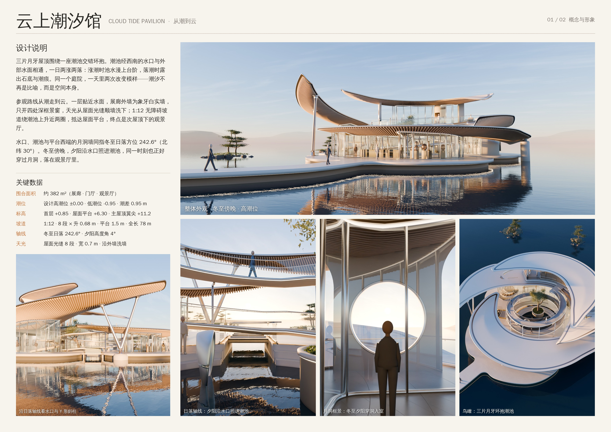
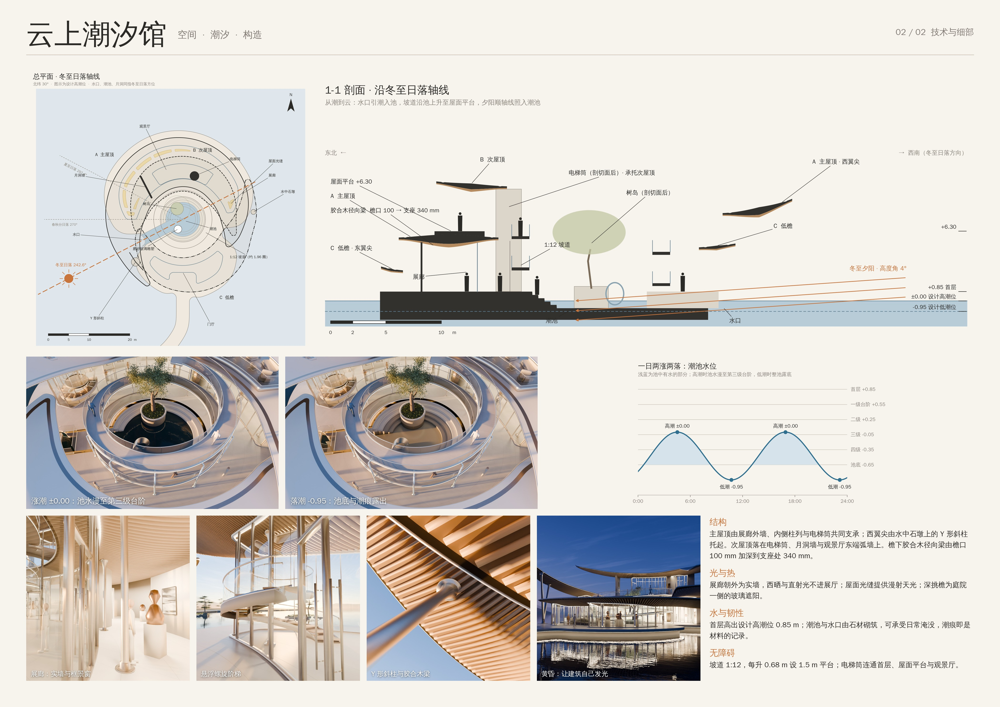
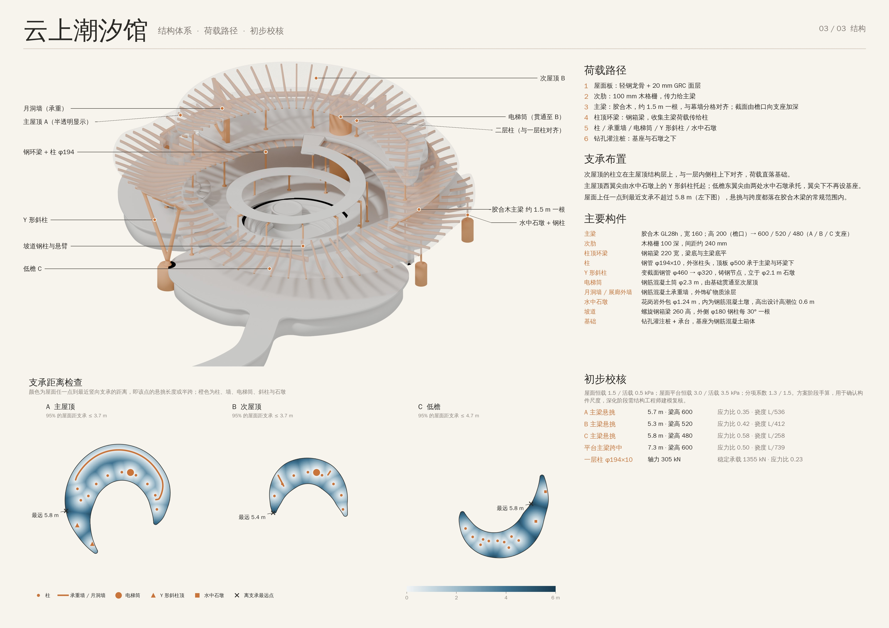

# 云上潮汐馆 · Cloud Tide Pavilion

一座浮在水面上的小型展馆：三片月牙屋顶围绕一座会随潮涨落的庭院。模型用 Blender（bpy）以 Python 程序化生成，用 Cycles 渲染；分析图由同一套几何数据绘制。





## 设计说明

**潮汐庭院。** 三片月牙屋顶交错环抱一座阶梯式潮池。潮池经西南的水口与外部水面相通，一日两涨两落：设计高潮位 ±0.00 时池水漫至第三级台阶，低潮位 -0.95 时整池露底、留下潮痕。树岛立在池中，磨砂玻璃雕塑立在池底石台上，高潮时下半段没入水中。

**从潮到云。** 参观路线自下而上：
1. 栈桥 → 低矮门廊 → 门厅 → 视线直达潮池；
2. 一层展廊贴近水面，外墙为象牙白实墙，只开四处深框景窗；天光从屋面光缝顺墙洗下；
3. 1:12 无障碍坡道绕潮池上升约 1.96 圈，到达主屋顶上的屋面平台；
4. 次屋顶下的观景厅，西端隔着月洞墙看水和天。

**冬至日落轴线。** 场地按北纬 30° 计算：冬至日落方位 242.6°。水口、潮池与月洞墙都对准这个方向。冬至傍晚，夕阳沿水口照进潮池，同一时刻也穿过月洞落在观景厅里。

## 关键数据

| 项目 | 数值 |
|---|---|
| 围合面积 | 约 380 m²（展廊、门厅、观景厅） |
| 潮位 | 设计高潮位 ±0.00，低潮位 -0.95，潮差 0.95 m |
| 标高 | 首层 +0.85（高出高潮位 0.85 m），屋面平台 +6.30，主屋顶西翼尖 +11.2 |
| 潮池 | 四级台阶（+0.55 / +0.25 / -0.05 / -0.35），池底 -0.65；水口净宽 2.6 m |
| 坡道 | 1:12，8 段，每段升 0.68 m，段间 1.5 m 休息平台，全长约 78 m；上下两圈净高约 2.5 m |
| 天光 | 屋面光缝 8 段，宽 0.7 m，沿展廊外墙内侧布置 |
| 日照 | 冬至日落方位 242.6°，渲染时太阳高度角 4° |

## 结构体系

**荷载路径。** 屋面板（轻钢龙骨 + 20 mm GRC）→ 100 mm 木格栅次肋 → 胶合木主梁（约 1.5 m 一根，与幕墙分格对齐）→ 柱顶钢箱环梁 → 柱 / 承重墙 / 电梯筒 / Y 形斜柱 / 水中石墩 → 钻孔灌注桩。

**支承布置。**
- 主屋顶 A：展廊内侧柱列 + 西端高厅外侧柱列（每 3 个幕墙分格一根，约 4.5 m）、展廊北侧承重实墙、电梯筒、东翼尖下一根补充柱；西翼尖由水中石墩上的 Y 形斜柱两肢托起。
- 次屋顶 B：二层柱立在主屋顶结构层上，与一层内侧柱上下对齐；另由电梯筒（贯通至 B）、月洞墙和观景厅东端弧墙支承。
- 低檐 C：门厅内外两侧柱列、西端一根补充柱；东翼尖下的基座已切除（净高不足处改为水面），由两处水中石墩上的钢柱承托。
- 屋面上任一点到最近竖向支承不超过 5.8 m（`structure.py` 计算，展板三左下图）。

| 构件 | 做法 |
|---|---|
| 主梁 | 胶合木 GL28h，宽 160；高 200（檐口）→ 600 / 520 / 480（A / B / C 支座），截面随悬挑弯矩加深 |
| 次肋 | 木格栅 100 深，间距约 240 mm，端部统一收于阴影缝内线 |
| 柱顶环梁 | 钢箱梁 220 宽，梁底与主梁底平 |
| 柱 | 钢管 φ194×10，外张柱头，顶板 φ500 |
| Y 形斜柱 | 变截面钢管 φ460 → φ320，铸钢节点，立于 φ2.1 m 石墩 |
| 电梯筒 | 钢筋混凝土筒 φ2.3 m，由基础贯通至次屋顶 |
| 月洞墙 / 展廊外墙 | 钢筋混凝土承重墙，外饰矿物质涂层 |
| 水中石墩 | 花岗岩外包 φ1.24 m，高出设计高潮位 0.6 m |
| 坡道 | 螺旋钢箱梁 260 高，外侧 φ180 钢柱每 30° 一根，以钢悬臂托住经过的每一圈 |

**初步校核**（`structure.prelim_checks()`；屋面恒载 1.5 / 活载 0.5 kPa，屋面平台恒载 3.0 / 活载 3.5 kPa，分项系数 1.3 / 1.5）：

| 部位 | 跨度 / 悬挑 | 截面 | 应力比 | 挠度 |
|---|---|---|---|---|
| A 主梁悬挑 | 5.7 m | 160×600 | 0.35 | L/536 |
| B 主梁悬挑 | 5.3 m | 160×520 | 0.42 | L/412 |
| C 主梁悬挑 | 5.8 m | 160×480 | 0.58 | L/258 |
| 屋面平台主梁 | 7.3 m 简支 | 160×600 | 0.50 | L/739 |
| 一层柱（叠加二层柱） | 5.0 m | φ194×10 | 0.23（N = 305 kN，稳定承载 1355 kN） | — |

悬挑一律按“到最近支承的距离”当作悬臂计算，偏保守。这些是方案阶段的手算，只用来确认构件尺度是否合理；深化阶段需要结构工程师建模复核（风荷载、地震、木梁与钢环梁节点、桩基）。

## 构造

| 部位 | 做法 |
|---|---|
| 屋檐 | 楔形截面，边缘收薄到 0.15 m，半圆形拉丝金属包边；檐下 120 mm 阴影缝 |
| 排水 | 距檐口 0.45–0.75 m 一圈余弦形浅槽，内衬深色金属格栅 |
| 展廊外墙 | 象牙白矿物质实墙，四处两跨宽的框景窗，外挑 0.62 m 的古铜色深窗框 |
| 幕墙 | 等宽分段约 1.5 m，顶部金属收口带封至木梁底，室内侧暗藏洗木梁的灯带 |
| 潮池石材 | 高潮位以下颜色加深、表面湿润，近池底泛淡青褐色，低潮时显出潮痕 |
| 栏杆 | 分段玻璃（板缝 12 mm）+ φ48 圆管扶手 + 底部压条 |

## 文件

```
cloud-tide-pavilion/
├── model/
│   ├── cloud_tide_pavilion.blend   完整场景（集合分组、材质、灯光、相机）
│   └── cloud_tide_pavilion.glb     建筑主体 + 庭院（简化 PBR 材质，不含远景）
├── renders/                        各机位渲染图、分析图、结构轴测图、三张展板 board_01/02/03.jpg
└── src/
    ├── plan.py          全部几何定义：三片屋顶（含主梁高度）、围合体、潮池与水口、坡道、日落轴线、天窗
    ├── facade.py        幕墙分格、实墙段、框景窗与门的位置
    ├── structure.py     结构体系：柱网、承重墙、二层柱、支承距离检查、初步校核
    ├── architecture.py  屋顶与天窗、胶合木主次梁、幕墙与框景窗、基座与潮池、平台、坡道、电梯筒、柱 / 环梁 / 斜柱 / 石墩、螺旋楼梯、月洞墙
    ├── scenery.py       树岛与雕塑、室内陈设与画作射灯、家具、人物、岛屿松树、远山
    ├── materials.py     材质库（统一以 M_ 开头）
    ├── scene.py         天空（物理天空 + 程序化薄云）、灯光、相机（每个机位带曝光和潮位）
    ├── build.py         总装 → .blend
    ├── render.py        渲染指定机位；按相机切换涨潮/落潮水位，dusk 机位切换为黄昏
    ├── diagrams.py      总平面与日落轴线、沿轴线长剖面、潮位曲线、支承距离图
    ├── struct_axo.py    结构轴测图（屋面半透明，承重构件着色）与标注锚点
    ├── boards.py        三张 A1 展板排版
    └── export_glb.py    导出 GLB
```

### 场景分组（Outliner）

```
CloudTidePavilion
├── Architecture
│   ├── Roofs            Roof_A_Main / Roof_B_Upper / Roof_C_Low（_Shell、_EdgeTrim、_SoffitRibs、_PrimaryBeams_Glulam，A 另有 _Skylight_*）
│   ├── Envelopes        Envelope_E1_Gallery / E2_Lobby / E3_Belvedere（_Glass、_Mullions_Frames、_SolidWall、_WindowFrames、_CoveLED、_Columns）
│   ├── Plinth_Terraces  Plinth_And_Bridge、Courtyard_TidalBasin、Roof_Terrace_Deck、Terrace_MoonGate
│   ├── Structure        Structure_LiftCore、Structure_Supports（Supports_Columns / RingBeams_Steel / YStrut_Steel / StonePiers）
│   └── Circulation      Courtyard_Ramp、Hall_SpiralStair
├── Site                 Courtyard、Interior_Exhibits、Lights_GalleryAccent、Terrace_Furniture、People_ScaleFigures、Landscape
├── Lights
└── Cameras              Cam_hero / axis / axis_out / moon / court_ht / court_lt / aerial / interior / terrace / stair / structure / detail / dusk
```

## 重新生成

```bash
python -m venv venv && ./venv/bin/pip install bpy==5.2.2 shapely triangle scipy pillow matplotlib
cd cloud-tide-pavilion
../venv/bin/python src/build.py model/cloud_tide_pavilion.blend
../venv/bin/python src/render.py model/cloud_tide_pavilion.blend renders hero,axis,moon,court_ht,court_lt,aerial,axis_out,interior,terrace,stair,structure,detail,dusk --samples=128
../venv/bin/python src/struct_axo.py model/cloud_tide_pavilion.blend renders/struct_axo.png --samples=64
../venv/bin/python src/diagrams.py renders
../venv/bin/python src/boards.py renders renders renders
../venv/bin/python src/export_glb.py model/cloud_tide_pavilion.blend model/cloud_tide_pavilion.glb
```

调整造型时修改 `src/plan.py`：三片屋顶的 `rin_keys` / `w_keys` / `h_keys` 控制点，`SOLSTICE_SUNSET_AZ`（换纬度即可重算轴线），`BASIN_STEPS` 与潮位，坡道参数。木梁、幕墙高度、柱高、栏杆、分析图都会随之更新；改完运行 `python src/structure.py` 看支承距离与初步校核是否仍在合理范围。
